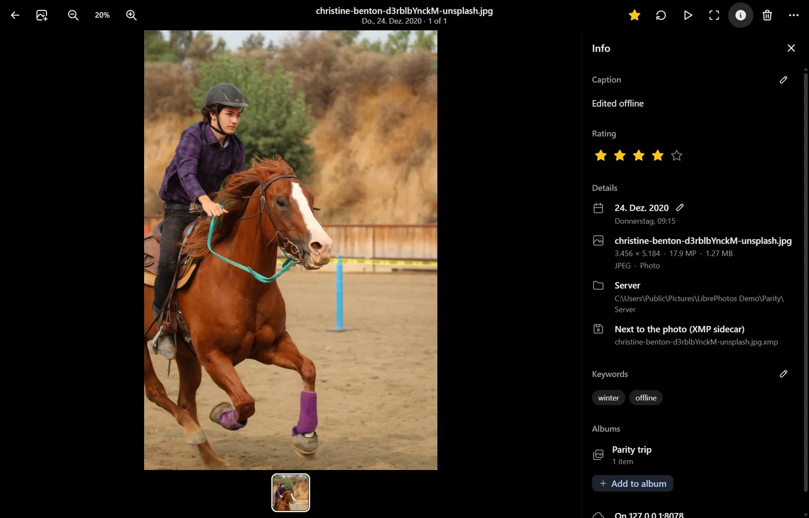

:::note Preview
The [desktop app](./index.md) is not released yet.
:::

The desktop app works on its own. Connecting it to your LibrePhotos server adds backup, the server's search, and what the server knows about a picture.

## Signing in

Open **LibrePhotos** in the sidebar, enter the **Server address** (`photos.example.com`; `https://` is assumed, `http://` for `localhost` and addresses in your home network), your **Username** and **Password**, and click **Sign in**. Your password is sent to your server only. The app keeps the sign-in in the Windows Credential Manager (on a Mac, in the login Keychain), so it stays signed in after a restart. **Sign out** on the same page forgets it.

## Backup

**Back up this library to** *your server* on the **LibrePhotos** page uploads every picture and video of your library folders that the server does not have yet, and new ones as they arrive. The app recognises a picture by its content (an MD5 checksum, the same the server uses), so pictures already on the server, uploaded from your phone or scanned from a server folder, are not uploaded again.

The page shows how many files are on the server, how many are **Only on this computer**, and the uploads under way. **Pause uploads** stops uploading (checks go on), and a failed upload can be retried. Uploads continue where they stopped after a restart. Uploads run while the app is open.

To upload one picture, also one outside the library, choose **Upload to LibrePhotos** in the viewer's **⋮** menu or in the info panel.

Uploading must be allowed on the server (**Allow uploads** in the admin settings), and your user needs a scan directory.

## What the server adds to the viewer

For a picture that is on the server, the [info panel](./viewer.md#the-info-panel) also shows:

- **People**: the names of the people the server recognised in it.
- **Albums**: the albums it is in, and **Add to album**, which adds it to one of your albums or makes a new one.
- **LibrePhotos**: the place name and the things the server found in it.

Your edits to its favourite, rating, caption, keywords and date taken are sent to the server too, see [Pictures on your LibrePhotos server](./editing.md#pictures-on-your-librephotos-server).

Without a connection, or for a picture the server does not have, these parts are hidden.
