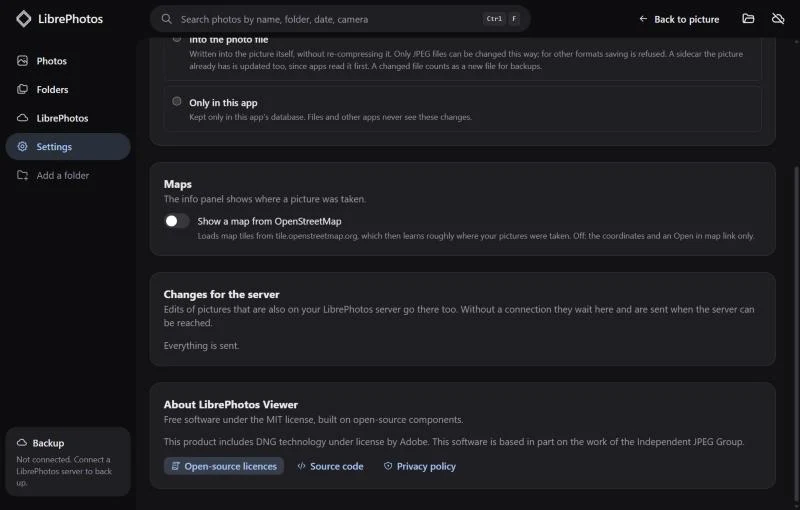
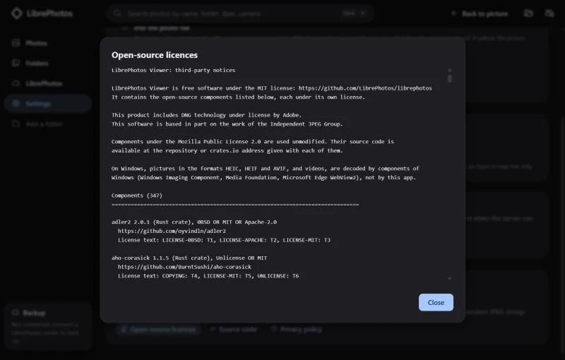

:::note Preview
The [desktop app](./index.md) is not released yet.
:::

Open **Settings** in the library's sidebar. Settings are saved in the app's database on this computer.

## Where edits are saved

Where favourites, ratings, captions, keywords and dates you change in the viewer are saved:

- **Next to the photo (XMP sidecar)**, the default: in a small `.xmp` file next to the picture. The picture is never changed. LibrePhotos, digiKam and darktable read the same file, and a Lightroom sidecar (`IMG_1234.xmp`) that is already there is updated.
- **Into the photo file**: inside the picture itself, without re-compressing it. Only JPEG files can be changed this way; for other formats saving is refused. A sidecar the picture already has is updated as well, since apps read the sidecar first. A changed file is a new file to a backup: a backed-up library uploads it again.
- **Only in this app**: in the app's database only. Files and other apps never see these changes.

The details are in [Where edits are saved](./editing.md#where-edits-are-saved).

## Maps

**Show a map from OpenStreetMap** adds a small map to the location of a picture in the info panel. It is off at first: the map is loaded from `tile.openstreetmap.org`, which then learns roughly where your pictures were taken. When it is off, the panel shows the coordinates and **Open in map**, which opens the place in your browser.

## Changes for the server

How many of your edits wait to be sent to your LibrePhotos server, for pictures that are on it (see [Pictures on your LibrePhotos server](./editing.md#pictures-on-your-librephotos-server)). **Everything is sent** when none wait. Changes the server refused stay here; **Try again** sends them once more.

## About and licences

<Since version="1.7.0" />

The last card, **About LibrePhotos Viewer**, shows the app's version and links to its **Source code** and its [privacy policy](./privacy.md).

**Open-source licences** lists every open-source component the app is built with, each with its license text. The same list is the file `THIRD-PARTY-NOTICES.txt` in the app's install folder.

